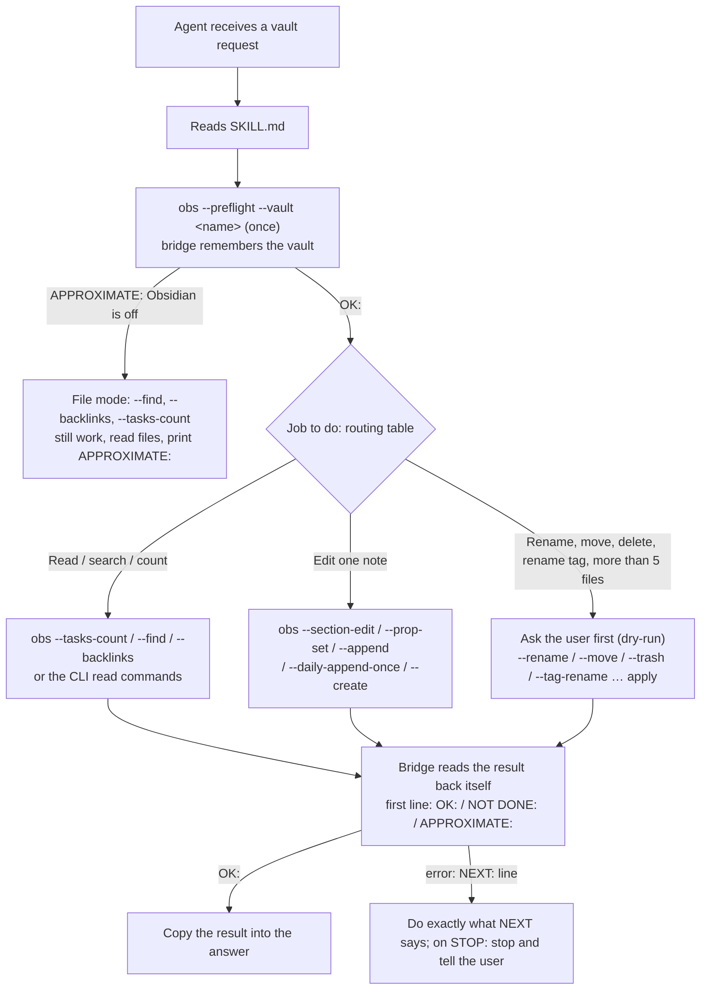

Language: English | [Tiếng Việt](HOW-IT-WORKS.md)

# How the obsidian-connect skill works

This document explains how the `obsidian-connect` skill runs and what each file in the skill does. It is up to date for **skill v2** (E8.6, E8.7): the mechanical work moved into the bridge, bridge output has a conclusion line and a `NEXT:` line, and SKILL.md was rewritten for cheaper models. The reasons are in [models/FAILURES.md](models/FAILURES.md). The numbers rely on Obsidian CLI 1.14.4 as measured in [FINDINGS.md](FINDINGS.md); the full design is in [SPEC.md](SPEC.md).

## 1. The main idea

An agent (Claude Code, etc.) needs to read, search and edit an Obsidian vault **without damaging notes, links or metadata**, using few turns and few tokens. The skill splits the work into three layers:

| Layer | File | Role |
|---|---|---|
| Instructions | `SKILL.md` + `references/*.md` | Teaches the agent which command to use for which job, the safety rules and the CLI traps |
| Safe execution | `scripts/obs.mjs` (bridge) | Calls the Obsidian CLI correctly in every environment, turns silent failures into clear exit codes, blocks dangerous operations |
| Vault conventions | `scripts/profile.mjs` | Reads the `.obsidian/` configuration so the agent writes in this vault's style |

Principle: **use Obsidian's index (through the CLI) for what needs an understanding of links, tags and tasks; use file tools for line-level content edits.** When Obsidian is not running, the skill can still work through files, but it must say plainly that the result is approximate.

## 2. Flow of one session



The concrete steps:

1. **Preflight, once only.** The agent asks the user for the vault name, then runs `obs --preflight --vault "<name>"`. The command prints at most 5 lines: the vault path, the environment, the CLI version and whether it matches the tested version, and the `alwaysUpdateLinks` setting. The bridge **remembers the vault** for 12 hours (a state file in the temp directory), so later commands do not need `OBS_VAULT`; `OBS_VAULT` or `--vault` still take priority when present. The bridge always sends `vault=<name>` as the **first** argument; without it the CLI would write to whichever vault is focused.
2. **Obsidian is off.** Preflight returns exit 2 immediately, with `APPROXIMATE:` on the first line, and still prints the vault path taken from Obsidian's `obsidian.json`. The bridge prints **only the vault that was asked for** and never prints the list of vaults. SKILL.md no longer tells the agent to read `obsidian.json` itself (that file contains the names of all of the user's real vaults).
3. **Profile.** Before writing a new note or a link, the agent runs `profile.mjs` to learn the vault's conventions.
4. **Pick the command from the routing table** in SKILL.md: one copy-paste command per job. For example, counting tasks is `obs --tasks-count`, and editing the 3rd line under a heading is `obs --section-edit … line=3 text="…"`.
5. **Read the conclusion line.** The bridge reads back after writing. The agent copies the `OK:`/`NOT DONE:`/`APPROXIMATE:` line into its answer, and on error follows the `NEXT:` line. The agent does not need to remember the exit-code table.

## 3. Role of each file

```
skills/obsidian-connect/
├── SKILL.md               always loaded when the skill activates
├── references/
│   ├── traps.md           full list of CLI traps, with evidence
│   ├── bulk-edit.md       procedure for multi-file edits and tag renames
│   ├── file-mode.md       what to do when there is no CLI
│   └── formats.md         Bases, JSON Canvas, web clipping
└── scripts/
    ├── obs.mjs            bridge that calls the Obsidian CLI
    ├── files.mjs          file read and edit part of the bridge (also used when Obsidian is off)
    └── profile.mjs        generates the vault profile
```

### `SKILL.md`: the main guide (~1.2k tokens in v2, v1 was ~1.6k)

The agent always reads this file first. It contains:
- **Frontmatter:** `name`, `description` (decides when the skill activates: only when working with an Obsidian vault, not plain Markdown), and `metadata.tested-cli: "1.15.0"` so it is clear which CLI version the skill was verified on.
- **Start:** ask for the vault name, run preflight once, run profile before writing a new note.
- **Read the output:** copy the `OK:`/`NOT DONE:`/`APPROXIMATE:` line into the answer; on error follow `NEXT:`. The exit-code table from v1 is gone.
- **Routing table:** 18 jobs, one copy-paste command each.
- **Safety thresholds** (unchanged from v1):
  - May do on its own: create or edit one note.
  - Must ask the user first (dry-run): rename, move, delete, rename a tag, or edit more than 5 files. The bridge takes the snapshot itself for `--rename`, `--move`, `--tag-rename … apply`.
  - Never: `delete permanent`, `mv`/`rm` on notes, `eval`, overwriting a whole note.
- The CLI traps live in `traps.md`; the bridge now blocks most of them itself.

SKILL.md is kept short because it costs tokens every time it is loaded. Details live in `references/` and are read only when needed.

### `references/`: read when needed

| File | When the agent reads it | Content |
|---|---|---|
| `traps.md` | On odd output, or when details are needed | Error strings and empty results that still exit 0; scope traps (`vault=` must come first, `active`); output-size traps (`search:context` can produce hundreds of KB); write traps (`create` makes `name 1.md`, `property:set` edits `types.json`, `daily:read` creates an empty note); environment traps (Git Bash calls the wrong `.exe`) |
| `bulk-edit.md` | Rename, move, delete, editing more than 5 files, renaming a tag | A 6-step procedure: dry-run, confirm, snapshot (git commit or copy into `.trash/obsidian-connect-snapshots/`), apply line-level edits, verify, report. How to rename a tag without touching `#projects`, code blocks or nested tags |
| `file-mode.md` | When preflight returns exit 2 | grep/rg commands with output limits for each job, stating where results may be incomplete (grep does not understand links the way Obsidian does). No rename/move, because links would break |
| `formats.md` | Working with `.base`, `.canvas`, web clips | Structure of Bases (YAML) and JSON Canvas, how to check a file is valid, the web-clip procedure. Rewritten in our own words from kepano's skill (MIT) |

### `scripts/obs.mjs`: the bridge

A single Node script that runs on WSL, PowerShell, cmd and Git Bash. It exists because the raw CLI has many dangerous spots:

| Problem with the raw CLI | How the bridge handles it |
|---|---|
| WSL has no `obsidian` on PATH; Git Bash calls `Obsidian.exe` by mistake, so the command returns exit 127 | Finds `Obsidian.com` itself (cached), runs from a C: drive directory |
| A missing or misplaced `vault=` makes the command fall into the focused vault | Always inserts `vault=<OBS_VAULT>` as the first argument; refuses if it is missing (and no preflight was done) (exit 5) |
| `Error: …`, `Vault not found.`, `No … found.` all return exit 0 | Reads stdout and returns the real exit code: 3 = error, 4 = empty, 6 = Obsidian is loading |
| Obsidian is off | Exit 2 within about 150 ms, with a reminder to switch to file mode |
| A command hangs | 10-second timeout, exit 124, no retry |
| `rename`/`move` with "auto update links" off shows a dialog, the CLI hangs, links break | `--rename` / `--move`: check the setting first; count backlinks and unresolved links before and after (wait up to 30 seconds for the index to update); on mismatch exit 7 |
| `move` into a folder that does not exist fails with ENOENT | `--move` creates the folder first |
| `delete` goes to the Windows Recycle Bin, ignoring the `.trash` setting | `--trash`: moves the file into `<vault>/.trash/` and reports how many backlinks will break |
| `create` on an existing file silently makes `name 1.md` | `--create`: refuses if the file already exists |
| Raw write commands (`create`, `append`, `prepend`, `property:set`, `property:remove`, `daily:append`, `delete`, `rename`, `move`) | Refused (exit 5), with a `NEXT:` line naming the right bridge command. `--allow-unsafe` (only after the user confirms) unlocks these commands, **except `rename`/`move`** |
| Dangerous commands | Blocked (exit 7): installing plugins/themes, `history:restore`, `command`, `overwrite`, `property:set type=`; unlocked with `--allow-unsafe` after the user confirms. `eval` and `dev:*` can **never** be unlocked |
| `daily:read` creates an empty note if none exists | The bridge checks with `daily:path` first; if there is no note it returns exit 4 and creates nothing |
| Nonexistent commands (`exec`, `grep`, typos) | Exit 5 with `NEXT:`, no longer mistaken for "Obsidian is loading" (exit 6). `vaults` is blocked so the vault list is not exposed |
| The model forgets `path=` | `obs read "a b.md"`, and even `obs read a b.md` without quotes, is understood as `path=a b.md` |
| The model keeps repeating the same failing command | On the 3rd consecutive identical command with the same error: `NEXT: STOP: same error 3 times…` |

The bridge's own commands (starting with `--`):

| Command | Effect |
|---|---|
| `--preflight` | Checks environment, CLI, vault, settings (≤ 5 lines); remembers the vault. With Obsidian off it still prints the vault path |
| `--find "<text>"` | Finds notes: automatically quotes the phrase, also searches the unaccented form (`Đà Nẵng` and `Da Nang`), limit 20, puts notes whose name matches first |
| `--backlinks path=` | Which notes link to this note. With Obsidian off it reads files itself (skips code blocks, handles links by alias separately) |
| `--tasks-count` | Counts open tasks in the whole vault (`done`: finished tasks) |
| `--section-edit path= heading=` | Without `line=`: prints the lines under the heading, numbered. `line=<n> text=`: replaces line n; `after=<n> text=`: inserts. Preserves CRLF |
| `--prop-set path= name=` | Edits frontmatter in the file, keeping types per `types.json` (number, date, checkbox, list), `add=`/`remove=` for lists, `unset` deletes the key. Does not touch `types.json` |
| `--append path= content=` | Adds a line at the end of the note using the note's own line-ending style; `once`: skip if the line already exists |
| `--daily-append-once content=` | Adds a line to today's daily note exactly once; creates the note via `daily:append` (with template) if missing, never calls `daily:read` |
| `--tag-rename from= to=` | Without `apply`: only prints the plan (dry run). With `apply`: snapshot, edits the note body and `tags:` in frontmatter, skips code, does not touch `#projects` or nested tags (unless `nested=yes`), verifies afterwards |
| `--abs <path>` | Converts a path inside the vault to an absolute path for the environment (`/mnt/c/...` on WSL, `C:\...` on Windows) |
| `--rename`, `--move` | Rename or move with link verification; snapshots the note and the notes linking to it. If link updating is off, refuses, with no way to override |
| `--trash` | Safe delete into `.trash/` |
| `--create` | Creates a note without overwriting or duplicating |
| `--help` | Prints the list of commands above |

**Output format (v2).** Every bridge command prints a conclusion on the first line: `OK:` (done and read back), `NOT DONE:` (not done, with the reason; a dry run is also `NOT DONE`), or `APPROXIMATE:` (Obsidian is off, read from files, may be incomplete). Every non-zero exit ends with a `NEXT: <what to do>` line on stderr. Read commands passed straight to the CLI (`obs read`, `obs outline`, …) still print the CLI's stdout unchanged.

Environment variables: `OBS_VAULT` (no longer required after preflight), `OBS_VAULT_DIR` (vault directory when it cannot be found), `OBS_TIMEOUT` (seconds, default 10), `OBS_CLI` (specify the CLI path), `OBS_VERIFY_MS` (wait time for link verification), `OBS_LOG` (log every call, used when measuring tests), `OBS_STATE` (the vault-memory file), `OBS_OBSIDIAN_JSON` (specify `obsidian.json`, used in sandboxes and tests).

Exit-code table (the agent does not need to remember it: the `NEXT:` line says what to do):

| Code | Meaning | What the agent should do |
|---|---|---|
| 0 | OK | Use the result |
| 2 | Cannot reach the CLI | Switch to file mode |
| 3 | The CLI reported an error | Read the message, fix the command |
| 4 | Empty result | Re-check `path=` and spelling before concluding "none" |
| 5 | Wrong usage, missing vault, nonexistent command, or raw write command | Follow `NEXT:` (usually the correct bridge command) |
| 6 | Obsidian is loading | Wait 2 seconds, retry **once** |
| 7 | Blocked for safety, or the post-write check failed | Stop, tell the user |
| 124 | Timeout | Do not retry, tell the user |

### `scripts/profile.mjs`: the vault profile

Reads `.obsidian/*.json` and prints about 25 lines of YAML. Every value is annotated with its source (`# from app.json` or `# default`). The agent uses the profile to:
- write links in the right style (`[[wikilink]]` or `[text](path.md)`);
- put new notes and daily notes in the right folder and date format, using the right template;
- know which properties have a fixed type (`tags`, `aliases`, number and date types) so it edits them in the file instead of using `property:set`;
- know which folders are excluded, and whether the vault has Drive conflict copies.

The script does not read note content, does not need Obsidian running, and writes nothing into the vault.

## 4. Three example scenarios

**Asked "How many open tasks are there?"**
```
obs --preflight --vault vault-copy   → OK: vault "vault-copy" at /mnt/c/... (4 lines)
obs --tasks-count                    → OK: 114 open tasks in the whole vault (Obsidian index)
```
Two calls, about 60 tokens of output. The agent does not list the tasks because the user only asked for the count.

**Renaming a note that 9 other notes link to**
1. Ask the user (dry-run): which note is renamed, and which 9 notes have links that Obsidian will update.
2. `obs --rename path="Target Note.md" name="Target Renamed"` → `OK: renamed Target Note.md -> Target Renamed.md; backlinks 9->9; unresolved 87->87; snapshot in .trash/obsidian-connect-snapshots/<timestamp>/`. The bridge snapshots the note and the other 9 notes before renaming.
3. If "Automatically update internal links" is off: `NOT DONE: alwaysUpdateLinks is false …` and `NEXT: tell the user: turn on …`. There is no way around it, not even `--allow-unsafe`.

**Obsidian is off**
```
obs --preflight --vault vault-copy             → APPROXIMATE: Obsidian is not running … (exit 2), with the vault path
obs --backlinks path="Target Note.md"          → APPROXIMATE: 9 note(s) link to Target Note.md …
```
The agent copies the word "approximate" into its answer and refuses to rename.

## 5. Why it uses few tokens

The tokens of a task come from two sources:
- **The skill's text** that the agent has to read.
- **Tool output** poured into the context: command results, file content. This is usually the much larger part.

Every tool call also drags in another round of reasoning, so the real cost is **number of turns × amount of output per turn** (YARDSTICK). The skill cuts both sources.

### 5.1 The skill's text: load only what is needed

| Part | Loaded when | Size (estimate, characters ÷ 4) |
|---|---|---|
| `description` | Always in the skill list | 51 words |
| `SKILL.md` | When the skill activates | ~1.2k tokens (v1: ~1.6k) |
| Each `references/` file | Only when the job needs it | 550–1,100 tokens |
| **Typical task** (SKILL + the largest single reference) | | **≤ ~2.4k tokens** |

Compared with the surveyed repos (REPORT.md): pablo loads about 9k tokens (SKILL plus a 651-line reference), jackal about 1.8k. This skill does not copy the CLI command documentation in; when syntax is needed, the agent calls `obsidian help <command>`. `tests/size-check.mjs` checks this budget on every test run, so the skill does not slowly bloat.

### 5.2 Tool output: rules that keep output small

| Rule in the skill | Why it saves tokens | Measured result |
|---|---|---|
| **For a count question, stop at `total`** | Returns a single number instead of the whole list | Case 4: 24,499 bytes (~6,100 tokens) reduced to 248 bytes (~60 tokens) after fixing the skill |
| **Use Obsidian's index instead of reading files** | `backlinks`, `tasks`, `tags` answer from the existing index without opening thousands of notes | Counting 114 tasks across 1,845 notes: 1 command, output is just the number `114`. A whole-vault grep from WSL takes 5–8 seconds and returns every matching line |
| **Put phrases in quotes** | `query=Section A` matches each word separately, and `search:context` repeats each line by the number of matched words | Same question: 410 KB without quotes, 254 bytes with (F8c) |
| **Always use `path=` and `limit=`** | Narrows the search scope and caps the number of results | Case 6: searching "Đà Nẵng" across 1,845 notes, total output ~960 tokens (budget 4k) |
| **Outline, then read only the line range** | A long note is never read in full | Case 8a: a 2,974-line note, the agent reads only 8 lines, ~680 tokens for the whole task |
| **Line-level edits (Edit)** | No need to re-read or rewrite the whole file | Case 3: a 3-line diff, ~200 tokens |
| **`head -c 4000` for long output** | An upper bound on any long list | — |
| **Know which commands ignore `total`** | `search:context` and `bases` print everything even with `total`; the skill says to always add `limit` | Avoids one kind of output blow-up that the CLI does not warn about (F9f) |

### 5.3 Fewer calls

| Mechanism | Saving |
|---|---|
| **Preflight once, answer in ≤ 5 lines** | Environment, version, vault and settings arrive in one call. The agent does not have to try commands one by one to find out |
| **Clear exit codes** | The raw CLI reports errors as text with exit 0, so the agent often has to make extra calls to check, or retry many times. The bridge returns 3/4/6/7 immediately, with guidance |
| **Never retry on timeout or lost connection** | Obsidian off: detected in 1 call, about 150 ms (case 7) |
| **The bridge's combined commands** | `--rename` runs about 6 CLI commands internally (check the file, the setting, count links before and after, wait for the index) but prints just **one line** of result: `backlinks 9->9; unresolved 87->87; verified` |
| **Profile ~25 lines** | Replaces the agent opening and reading 5–6 JSON files in `.obsidian/` itself. Runs only when about to write; read-only tasks skip it |

### 5.4 Results measured on 11 scenarios

Estimated tool output per task (details: [tests/RESULTS.md](../tests/RESULTS.md)):

| Task | Turns | Output (estimate) |
|---|---|---|
| Count tasks in the whole vault | 3 | ~60 tokens |
| Edit 3 properties | 4 | ~200 tokens |
| List backlinks | 5 | ~300 tokens |
| Rename a note with 9 links pointing to it, with verification | 9 | ~380 tokens |
| Edit one line in a 2,974-line note | 5 | ~680 tokens |
| Find a topic across 1,845 notes | 4 | ~960 tokens |
| Rename a tag across the whole vault (with dry-run) | 10 | ~2,100 tokens |

How it is measured: the bridge's output bytes (recorded with `OBS_LOG`) plus the number of file lines the agent reads, divided by 4. These figures are **slightly lower than reality**, because they do not yet include output from the grep/cat commands the agent runs itself (see the gap in GATES.md, gate 3).

## 6. Testing and maintenance (outside the skill, inside the repo)

These files are not part of the skill when installed, but they keep the skill correct when Obsidian ships a new version:

| File | Role |
|---|---|
| `tests/bridge.test.mjs`, `tests/fake-obsidian.mjs` | Test every exit code, the output format (`OK:`/`NOT DONE:`/`APPROXIMATE:`, `NEXT:`) and each bridge command using a fake CLI (the `vault` mode simulates the CLI on a real fixture vault), no Obsidian needed |
| `tests/profile.test.mjs` | Checks that the profile reads the right values and does not leak note content |
| `tests/size-check.mjs` | Checks the size budget (description ≤ 60 words, SKILL ≤ 70 lines and no larger than v1, typical load ≤ 3k tokens) |
| `otf` (package [`obsidian-test-fixture`](https://github.com/vantt/obsidian-test-fixture), tag pinned in `tests/package.json`; path in `tests/otf.mjs`) | `otf generate --preset hard-cases` generates a fake vault with hard cases (every link style, a 3,000-line CRLF note, Vietnamese names, easily confused tags); `--preset personal-vault` generates a synthetic vault of ~1,800 notes for E8. `otf truth` computes the correct answers from files alone (backlinks, tasks, tags, YAML, CRLF) to grade results |
| `tests/compat/probes.mjs` | 32 probes that re-check every CLI behavior the skill relies on, scored by severity of damage, with history saved in `HISTORY.md` |
| `tests/compat/TROUBLESHOOTING.md` | Lessons for handling problems while measuring (slow index, reload, dialogs...) |
| `tests/scenarios/README.md`, `tests/RESULTS.md` | 13 test scenarios with real agents, plus the results of each run |

**When Obsidian ships a new version:** `obs --preflight` will report `match=no`. Then run `tests/compat/probes.mjs`, see which probes changed result in `HISTORY.md`, and update `traps.md`, SKILL.md and `TESTED_CLI`. Details in [tests/compat/README.md](../tests/compat/README.md).
