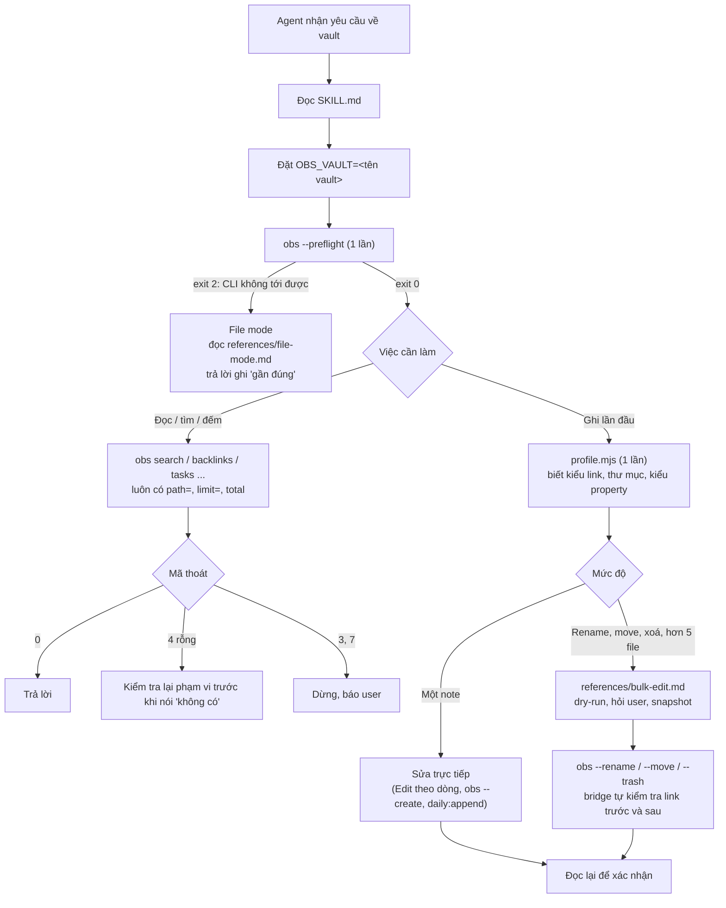

# Skill obsidian-connect hoạt động thế nào

Tài liệu này giải thích cách skill `obsidian-connect` chạy và vai trò của từng file trong skill. Số liệu dựa trên Obsidian CLI 1.14.4 đã đo trong [FINDINGS.md](FINDINGS.md); thiết kế đầy đủ nằm ở [SPEC.md](SPEC.md).

## 1. Ý tưởng chính

Agent (Claude Code, v.v.) cần đọc, tìm và sửa vault Obsidian mà **không làm hỏng note, link, metadata**, và tốn ít lượt và ít token. Skill chia việc thành ba lớp:

| Lớp | File | Vai trò |
|---|---|---|
| Hướng dẫn | `SKILL.md` + `references/*.md` | Dạy agent việc nào dùng lệnh nào, quy tắc an toàn và các bẫy của CLI |
| Thực thi an toàn | `scripts/obs.mjs` (bridge) | Gọi Obsidian CLI đúng cách trên mọi môi trường, biến các lỗi im lặng thành mã thoát rõ ràng, chặn thao tác nguy hiểm |
| Quy ước vault | `scripts/profile.mjs` | Đọc cấu hình `.obsidian/` để agent viết đúng kiểu của vault này |

Nguyên tắc: **dùng chỉ mục của Obsidian (qua CLI) cho những gì cần hiểu link, tag, task; dùng công cụ file cho sửa nội dung theo dòng.** Khi Obsidian không chạy, skill vẫn làm được bằng file nhưng phải ghi rõ là kết quả gần đúng.

## 2. Luồng một phiên làm việc



Các bước cụ thể:

1. **Đặt vault.** Agent đặt biến `OBS_VAULT`. Bridge luôn gửi `vault=<tên>` làm tham số **đầu tiên**. Nếu thiếu tham số này, CLI sẽ ghi vào vault đang được focus, có thể là vault thật.
2. **Preflight, chỉ một lần.** `obs --preflight` in tối đa 5 dòng: môi trường (WSL hay Windows), phiên bản CLI và việc nó có khớp bản đã test không, đường dẫn vault, cài đặt `alwaysUpdateLinks`. Nếu Obsidian tắt, lệnh trả exit 2 ngay lập tức, không treo và không thử lại.
3. **Profile.** Trước lần ghi đầu tiên, agent chạy `profile.mjs` để biết quy ước của vault.
4. **Chọn cách làm theo bảng routing** trong SKILL.md, ví dụ: đếm task dùng `tasks todo total`, sửa một mục trong note dài dùng `outline` rồi đọc đúng khoảng dòng rồi Edit.
5. **Kiểm tra mã thoát và đọc lại** sau mỗi lần ghi.

## 3. Vai trò từng file

```
skills/obsidian-connect/
├── SKILL.md               luôn được nạp khi skill kích hoạt
├── references/
│   ├── traps.md           danh sách bẫy CLI đầy đủ, kèm bằng chứng
│   ├── bulk-edit.md       quy trình sửa nhiều file và đổi tên tag
│   ├── file-mode.md       cách làm khi không có CLI
│   └── formats.md         Bases, JSON Canvas, clip web
└── scripts/
    ├── obs.mjs            bridge gọi Obsidian CLI
    └── profile.mjs        sinh vault profile
```

### `SKILL.md`: bản hướng dẫn chính (~1,6k token)

Agent luôn đọc file này đầu tiên. Nó gồm:
- **Frontmatter:** `name`, `description` (quyết định khi nào skill được kích hoạt: chỉ khi làm việc với vault Obsidian, không phải Markdown thông thường), và `metadata.tested-cli: "1.14.4"` để biết skill đã được kiểm chứng trên bản CLI nào.
- **Once per session:** đặt vault, chạy preflight, chạy profile.
- **Bảng mã thoát** của bridge.
- **Bảng routing:** 16 loại việc, mỗi loại kèm lệnh cụ thể và giới hạn output.
- **Ngưỡng an toàn:**
  - Được tự làm: tạo hoặc sửa một note.
  - Phải dry-run, hỏi user và snapshot trước: rename, move, xoá, hoặc sửa hơn 5 file.
  - Không bao giờ: `delete permanent`, `mv` trên note.
- **Các bẫy quan trọng nhất.** Danh sách đầy đủ để ở `traps.md`.

SKILL.md được giữ ngắn vì nó tốn token mỗi lần nạp. Chi tiết nằm ở `references/` và chỉ được đọc khi cần.

### `references/`: đọc khi cần

| File | Khi nào agent đọc | Nội dung |
|---|---|---|
| `traps.md` | Khi gặp output lạ, hoặc cần chi tiết | Các chuỗi lỗi và kết quả rỗng mà vẫn exit 0; bẫy phạm vi (`vault=` phải đứng đầu, `active`); bẫy kích thước output (`search:context` có thể ra hàng trăm KB); bẫy khi ghi (`create` tạo `tên 1.md`, `property:set` sửa `types.json`, `daily:read` tạo note rỗng); bẫy môi trường (Git Bash gọi nhầm `.exe`) |
| `bulk-edit.md` | Rename, move, xoá, sửa hơn 5 file, đổi tên tag | Quy trình 6 bước: dry-run, xác nhận, snapshot (git commit hoặc copy vào `.trash/obsidian-connect-snapshots/`), áp dụng sửa theo dòng, kiểm tra lại, báo cáo. Cách đổi tên tag mà không đụng `#projects`, code block hay tag con |
| `file-mode.md` | Khi preflight trả exit 2 | Các lệnh grep/rg có giới hạn output cho từng việc, chỉ rõ chỗ nào có thể thiếu (grep không hiểu link như Obsidian). Không cho rename/move vì link sẽ gãy |
| `formats.md` | Làm việc với `.base`, `.canvas`, clip web | Cấu trúc Bases (YAML) và JSON Canvas, cách kiểm tra file hợp lệ, quy trình clip trang web. Viết lại theo ý từ skill của kepano (MIT) |

### `scripts/obs.mjs`: bridge

Một script Node duy nhất, chạy được trên WSL, PowerShell, cmd và Git Bash. Nó tồn tại vì CLI thô có nhiều chỗ nguy hiểm:

| Vấn đề của CLI thô | Bridge xử lý |
|---|---|
| WSL không có `obsidian` trên PATH; Git Bash gọi nhầm `Obsidian.exe` nên lệnh trả exit 127 | Tự tìm `Obsidian.com` (lưu cache), chạy từ thư mục ổ C: |
| Thiếu `vault=` hoặc đặt sai vị trí thì lệnh rơi vào vault đang focus | Luôn chèn `vault=<OBS_VAULT>` làm tham số đầu tiên; thiếu thì từ chối (exit 5) |
| `Error: …`, `Vault not found.`, `No … found.` đều trả exit 0 | Đọc stdout và trả mã thoát thật: 3 = lỗi, 4 = rỗng, 6 = Obsidian đang tải |
| Obsidian tắt | Exit 2 trong khoảng 150 ms, kèm lời nhắc chuyển sang file mode |
| Lệnh treo | Timeout 10 giây, exit 124, không thử lại |
| `rename`/`move` khi tắt "auto update links" thì hiện hộp thoại và CLI treo, link gãy | `--rename` / `--move`: kiểm tra cài đặt trước; đếm backlink và unresolved trước và sau (chờ tối đa 30 giây cho index cập nhật); lệch thì exit 7 |
| `move` vào thư mục chưa có thì lỗi ENOENT | `--move` tạo thư mục trước |
| `delete` vào Thùng rác Windows, bỏ qua cài đặt `.trash` | `--trash`: chuyển file vào `<vault>/.trash/` và báo số backlink sẽ gãy |
| `create` trên file đã có thì lặng lẽ tạo `tên 1.md` | `--create`: từ chối nếu file đã tồn tại |
| Lệnh nguy hiểm | Chặn `delete`, `eval`, `dev:*`, cài plugin, `overwrite`, `property:set type=`, `rename`/`move`/`create` thô. Chỉ cho chạy khi có `--allow-unsafe`, và agent chỉ được dùng sau khi user xác nhận |

Các lệnh riêng của bridge (bắt đầu bằng `--`):

| Lệnh | Tác dụng |
|---|---|
| `--preflight` | Kiểm tra môi trường, CLI, vault, cài đặt (≤ 5 dòng) |
| `--abs <đường dẫn>` | Đổi đường dẫn trong vault thành đường dẫn tuyệt đối theo môi trường (`/mnt/c/...` trên WSL, `C:\...` trên Windows) |
| `--rename`, `--move` | Đổi tên hoặc di chuyển có kiểm tra link |
| `--trash` | Xoá an toàn vào `.trash/` |
| `--create` | Tạo note mà không ghi đè hoặc nhân bản |

Biến môi trường: `OBS_VAULT` (bắt buộc), `OBS_TIMEOUT` (giây, mặc định 10), `OBS_CLI` (chỉ định đường dẫn CLI), `OBS_VERIFY_MS` (thời gian chờ kiểm tra link), `OBS_LOG` (ghi log từng lần gọi, dùng khi đo test).

Bảng mã thoát:

| Mã | Ý nghĩa | Agent nên làm gì |
|---|---|---|
| 0 | OK | Dùng kết quả |
| 2 | Không gọi được CLI | Chuyển sang file mode |
| 3 | CLI báo lỗi | Đọc thông báo, sửa lệnh |
| 4 | Kết quả rỗng | Kiểm tra lại `path=` và chính tả trước khi kết luận "không có" |
| 5 | Sai cách dùng hoặc thiếu vault | Đặt `OBS_VAULT` |
| 6 | Obsidian đang tải | Chờ 2 giây, thử lại **một** lần |
| 7 | Bị chặn vì an toàn, hoặc kiểm tra sau khi ghi thất bại | Dừng, báo user |
| 124 | Timeout | Không thử lại, báo user |

### `scripts/profile.mjs`: vault profile

Đọc `.obsidian/*.json` và in khoảng 25 dòng YAML. Mỗi giá trị có ghi nguồn (`# from app.json` hoặc `# default`). Agent dùng profile để:
- viết link đúng kiểu (`[[wikilink]]` hay `[text](path.md)`);
- đặt note mới và daily note đúng thư mục và định dạng ngày, dùng đúng template;
- biết property nào có kiểu cố định (`tags`, `aliases`, kiểu số, ngày) để sửa trong file, không dùng `property:set`;
- biết thư mục nào bị loại trừ, và vault có bản xung đột Drive hay không.

Script không đọc nội dung note, không cần Obsidian chạy, và không ghi gì vào vault.

## 4. Ví dụ ba tình huống

**Hỏi "Có bao nhiêu task chưa xong?"**
```
obs --preflight                → env=wsl cli=1.14.4 match=yes ...
obs tasks todo total           → 114
```
Hai lần gọi, khoảng 60 token output. Agent không liệt kê task vì user chỉ hỏi số lượng.

**Đổi tên một note có 9 note khác trỏ tới**
1. Dry-run: liệt kê 9 file và dòng link sẽ đổi, rồi hỏi user.
2. Snapshot bằng git (hoặc ghi lại HEAD nếu cây git đã sạch).
3. `obs --rename path="Target Note.md" name="Target Renamed"` → `backlinks 9->9; unresolved 87->87; verified`.

**Obsidian đang tắt**
```
obs --preflight   → cli-status=Obsidian is not running -> use file mode   (exit 2)
```
Agent đọc `file-mode.md`, tìm backlink bằng grep, ghi rõ "kết quả gần đúng", và từ chối rename.

## 5. Vì sao ít tốn token

Token của một tác vụ đến từ hai nguồn:
- **Chữ của skill** mà agent phải đọc.
- **Output của các công cụ** đổ vào context: kết quả lệnh, nội dung file. Đây thường là phần lớn hơn nhiều.

Mỗi lượt gọi công cụ còn kéo theo một vòng suy luận nữa, nên chi phí thực tế là **số lượt × lượng output mỗi lượt** (YARDSTICK). Skill cắt giảm cả hai nguồn.

### 5.1 Chữ của skill: chỉ nạp phần cần dùng

| Phần | Nạp khi nào | Kích thước (ước tính, ký tự ÷ 4) |
|---|---|---|
| `description` | Luôn có trong danh sách skill | 51 từ |
| `SKILL.md` | Khi skill được kích hoạt | ~1,6k token |
| Mỗi file `references/` | Chỉ khi việc cần đến | 550–1.100 token |
| **Tác vụ điển hình** (SKILL + một reference lớn nhất) | | **≤ ~2,7k token** |

So sánh với các repo đã khảo sát (REPORT.md): pablo nạp khoảng 9k token (SKILL cộng reference 651 dòng), jackal khoảng 1,8k. Skill này không chép tài liệu lệnh CLI vào; khi cần cú pháp, agent gọi `obsidian help <lệnh>`. `tests/size-check.mjs` kiểm tra ngân sách này mỗi lần chạy test, để skill không phình dần.

### 5.2 Output công cụ: các quy tắc làm output nhỏ

| Quy tắc trong skill | Vì sao tiết kiệm | Số đo thực tế |
|---|---|---|
| **Hỏi số lượng thì dừng ở `total`** | Chỉ trả về một con số, thay vì cả danh sách | Case 4: 24.499 byte (~6.100 token) giảm còn 248 byte (~60 token) sau khi sửa skill |
| **Dùng chỉ mục của Obsidian thay vì đọc file** | `backlinks`, `tasks`, `tags` trả lời từ chỉ mục có sẵn, không phải mở hàng nghìn note | Đếm 114 task trên 1.845 note: 1 lệnh, output chỉ là con số `114`. Grep toàn vault từ WSL mất 5–8 giây và trả về từng dòng khớp |
| **Đặt cụm từ trong ngoặc kép** | `query=Section A` khớp từng từ riêng, còn `search:context` lặp mỗi dòng theo số từ khớp | Cùng câu hỏi: 410 KB khi không có ngoặc kép, 254 byte khi có (F8c) |
| **Luôn có `path=` và `limit=`** | Thu hẹp phạm vi tìm và chặn số kết quả | Case 6: tìm "Đà Nẵng" trên 1.845 note, tổng output ~960 token (ngân sách 4k) |
| **Outline rồi đọc đúng khoảng dòng** | Note dài không bao giờ bị đọc hết | Case 8a: note 2.974 dòng, agent chỉ đọc 8 dòng, ~680 token cả tác vụ |
| **Sửa theo dòng (Edit)** | Không phải đọc lại hay ghi lại cả file | Case 3: diff 3 dòng, ~200 token |
| **`head -c 4000` cho output dài** | Chặn trên cho mọi danh sách dài | — |
| **Biết lệnh nào bỏ qua `total`** | `search:context` và `bases` in toàn bộ dù có `total`; skill dặn luôn kèm `limit` | Tránh được một dạng bùng output mà CLI không báo (F9f) |

### 5.3 Ít lượt gọi hơn

| Cơ chế | Tiết kiệm |
|---|---|
| **Preflight một lần, trả lời trong ≤ 5 dòng** | Môi trường, phiên bản, vault và cài đặt có trong một lần gọi. Agent không phải thử từng lệnh để tìm hiểu |
| **Mã thoát rõ ràng** | CLI thô báo lỗi bằng chữ kèm exit 0, nên agent hay phải gọi thêm để kiểm tra, hoặc thử lại nhiều lần. Bridge trả 3/4/6/7 ngay, kèm hướng xử lý |
| **Không bao giờ thử lại khi timeout hoặc mất kết nối** | Obsidian tắt: phát hiện trong 1 lần gọi, khoảng 150 ms (case 7) |
| **Lệnh gộp của bridge** | `--rename` tự chạy khoảng 6 lệnh CLI bên trong (kiểm tra file, cài đặt, đếm link trước và sau, chờ chỉ mục) nhưng chỉ in **một dòng** kết quả: `backlinks 9->9; unresolved 87->87; verified` |
| **Profile ~25 dòng** | Thay cho việc agent tự mở và đọc 5–6 file JSON trong `.obsidian/`. Chỉ chạy khi sắp ghi; tác vụ chỉ đọc thì bỏ qua |

### 5.4 Kết quả đo trên 11 kịch bản

Ước tính output công cụ của mỗi tác vụ (chi tiết: [tests/RESULTS.md](../tests/RESULTS.md)):

| Tác vụ | Số lượt | Output (ước tính) |
|---|---|---|
| Đếm task toàn vault | 3 | ~60 token |
| Sửa 3 property | 4 | ~200 token |
| Liệt kê backlink | 5 | ~300 token |
| Đổi tên note có 9 link trỏ tới, có kiểm tra | 9 | ~380 token |
| Sửa một dòng trong note 2.974 dòng | 5 | ~680 token |
| Tìm chủ đề trong 1.845 note | 4 | ~960 token |
| Đổi tên tag trên toàn vault (có dry-run) | 10 | ~2.100 token |

Cách đo: số byte output của bridge (ghi bằng `OBS_LOG`) cộng số dòng file agent đọc, chia 4. Các con số này **thấp hơn thực tế một chút**, vì chưa tính output từ các lệnh grep/cat mà agent tự chạy (xem lỗ hổng ở GATES.md, cổng 3).

## 6. Kiểm thử và bảo trì (ngoài skill, trong repo)

Các file này không phải một phần của skill khi cài đặt, nhưng giữ cho skill đúng khi Obsidian ra bản mới:

| File | Vai trò |
|---|---|
| `tests/bridge.test.mjs`, `tests/fake-obsidian.mjs` | Kiểm tra mọi mã thoát của bridge bằng CLI giả, không cần Obsidian |
| `tests/profile.test.mjs` | Kiểm tra profile đọc đúng giá trị và không lộ nội dung note |
| `tests/size-check.mjs` | Kiểm tra ngân sách kích thước (mô tả ≤ 60 từ, SKILL ≤ 100 dòng, tải điển hình ≤ 3k token) |
| `tests/fixtures/gen-fixture.mjs` | Sinh vault giả với các trường hợp khó: đủ kiểu link, note CRLF 3.000 dòng, tên tiếng Việt, tag dễ nhầm |
| `tests/ground-truth/gt.mjs` | Tính đáp án đúng chỉ từ file (backlink, task, tag, YAML, CRLF) để chấm kết quả |
| `tests/compat/probes.mjs` | 29 probe kiểm tra lại từng hành vi CLI mà skill dựa vào, chấm điểm theo mức độ thiệt hại, lưu lịch sử vào `HISTORY.md` |
| `tests/compat/TROUBLESHOOTING.md` | Kinh nghiệm xử lý sự cố khi đo (index chậm, reload, hộp thoại...) |
| `tests/scenarios/README.md`, `tests/RESULTS.md` | 11 kịch bản test với agent thật, cùng kết quả từng lần chạy |

**Khi Obsidian ra bản mới:** `obs --preflight` sẽ báo `match=no`. Khi đó chạy `tests/compat/probes.mjs`, xem probe nào đổi kết quả trong `HISTORY.md`, rồi cập nhật `traps.md`, SKILL.md và `TESTED_CLI`. Chi tiết ở [tests/compat/README.md](../tests/compat/README.md).
