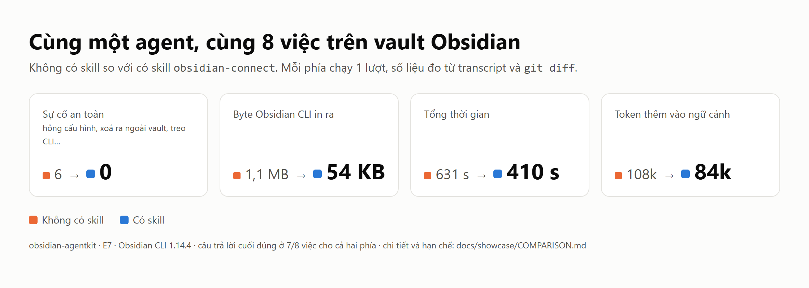

# Tư liệu diễn tập "có skill / không có skill" (E7)

Kho tư liệu cho bài viết và video. Cùng một agent làm 8 việc trên bản sao vault Obsidian, một lần không có skill và một lần có skill `obsidian-connect`. Mọi số liệu đều đo được và dựng lại được.

Plan: [docs/plans/E7-showcase.md](../plans/E7-showcase.md) · Công cụ đo: [tests/showcase/](../../tests/showcase/README.md) · Ngày chạy: 2026-10-22 · Obsidian CLI 1.14.4.



## Đọc theo thứ tự nào

| Bạn cần | Mở |
|---|---|
| Kết luận và số liệu, kèm hạn chế | [COMPARISON.md](COMPARISON.md) |
| Câu hook kèm số liệu và link bằng chứng | [STORIES.md](STORIES.md) |
| Bài viết nháp, bản dài và bản ngắn | [POST.md](POST.md) |
| Kịch bản video 60–90 giây và storyboard | [VIDEO-SCRIPT.md](VIDEO-SCRIPT.md) |
| Kiểm tra quyền riêng tư, việc user cần duyệt | [PRIVACY.md](PRIVACY.md) |
| Chi tiết một tình huống | `scenarios/S1` … `S8`, mỗi thư mục có README |

## Tám tình huống

| # | Việc | Không có skill | Có skill | Chi tiết |
|---|---|---|---|---|
| S1 | Đếm task chưa xong | đúng 114 | đúng 114 | [S1](scenarios/S1/README.md) |
| S2 | Đổi tên note khi tắt tự cập nhật link | xong, nhưng treo 159 s và tự bấm hộp thoại bằng JS | từ chối an toàn, giải thích | [S2](scenarios/S2/README.md) |
| S3 | Đổi tag `#proj` | đúng | đúng | [S3](scenarios/S3/README.md) |
| S4 | Thêm tag, đặt `rating` | **hỏng `types.json` của cả vault, báo sai** | đúng | [S4](scenarios/S4/README.md) |
| S5 | Xoá note có 9 backlink | vào Recycle Bin của Windows | vào `.trash/` của vault | [S5](scenarios/S5/README.md) |
| S6 | Tìm note về Đà Nẵng | cùng 3 note, 27,9k token | cùng 3 note, 8,7k token | [S6](scenarios/S6/README.md) |
| S7 | Obsidian tắt | đúng 9, có ghi "có thể chưa đủ" | đúng 9, ghi "approximate" | [S7](scenarios/S7/README.md) |
| S8 | Ghi daily note, 2 phiên | `daily:read` tạo note rỗng, ghi đè cả file | đúng | [S8](scenarios/S8/README.md) |

## Cấu trúc thư mục

```text
docs/showcase/
├── README.md            mục lục (file này)
├── COMPARISON.md        bảng so sánh 5 mặt, cách đo, hạn chế          (E7.4)
├── STORIES.md           9 câu hook kèm số liệu và bằng chứng          (E7.6)
├── POST.md              bài viết nháp: dài, ngắn, câu mở đầu A/B      (E7.7)
├── VIDEO-SCRIPT.md      kịch bản và storyboard 10 cảnh                (E7.7)
├── PRIVACY.md           kết quả quét và checklist cho user            (E7.8)
├── data/
│   ├── results.csv      1 dòng mỗi tình huống × phía (S8 cộng 2 phiên)
│   ├── results.json     như trên, kèm danh sách sự cố và ghi chú
│   └── totals.json      tổng mỗi phía
├── assets/                                                           (E7.5)
│   ├── charts/          biểu đồ SVG và PNG, scorecard (PNG và HTML nguồn)
│   ├── obsidian/        ảnh Obsidian cắt sát một phần tử, chỉ fixture
│   ├── terminal/        quay terminal trước/sau: .gif, .mp4, .tape (quay lại bằng vhs)
│   └── diffs/           diff dạng ảnh (PNG và HTML nguồn)
└── scenarios/S1…S8/
    ├── README.md        prompt nguyên văn, bảng kết quả hai phía, link bằng chứng, cách dựng lại
    ├── without/         phía không có skill (S8: thêm without2/ cho phiên 2)
    └── with/            phía có skill       (S8: thêm with2/)
        ├── transcript.md   từng lệnh agent gọi, output, câu trả lời (đã che dữ liệu thật)
        ├── answer.txt      câu trả lời nguyên văn
        ├── metrics.json    lượt, byte, token (usage API), thời gian
        ├── check.json      chấm từ trạng thái vault: thiệt hại và ground truth
        ├── lab.diff        git diff của fixture và .obsidian/types.json
        ├── cli-calls.txt   mọi lệnh CLI thật sự chạy: tham số, exit, byte, ms
        └── baseline.json   trạng thái trước khi chạy
```

S6 chạy trên note thật, nên chỉ có `metrics.json`, `check.json`, `baseline.json` và `cli-by-command.json`.

## Danh mục hình ảnh

| File | Nội dung | Tình huống |
|---|---|---|
| [charts/scorecard.png](assets/charts/scorecard.png) | 4 con số chính | tất cả |
| [charts/incidents.png](assets/charts/incidents.png) | sự cố an toàn theo tình huống | tất cả |
| [charts/context-tokens.png](assets/charts/context-tokens.png) | token thêm vào ngữ cảnh | tất cả |
| [charts/wall-time.png](assets/charts/wall-time.png) | thời gian | tất cả |
| [charts/cli-output.png](assets/charts/cli-output.png) | byte CLI in ra | tất cả |
| [charts/tool-calls.png](assets/charts/tool-calls.png) | số lượt gọi công cụ | tất cả |
| [obsidian/rename-modal.png](assets/obsidian/rename-modal.png) | hộp thoại "Update links" chặn CLI | S2 |
| [obsidian/links-before.png](assets/obsidian/links-before.png), [links-broken.png](assets/obsidian/links-broken.png) | link trước, và sau khi gãy | S2 |
| [obsidian/properties-before.png](assets/obsidian/properties-before.png), [properties-after.png](assets/obsidian/properties-after.png) | UI trông bình thường dù `types.json` đã đổi | S4 |
| [obsidian/duplicate-file-explorer.png](assets/obsidian/duplicate-file-explorer.png) | `create` trên đường dẫn đã có sinh ra `ref-wikilink 1.md` | bẫy F9c |
| [diffs/s4-types-json-diff.png](assets/diffs/s4-types-json-diff.png) | diff `types.json` | S4 |
| [terminal/s2-rename.gif](assets/terminal/s2-rename.gif) | rename treo, exit 124, 87 → 89 link gãy; bridge exit 7 | S2 |
| [terminal/s4-types-json.gif](assets/terminal/s4-types-json.gif) | `property:set` đổi `types.json`; bridge chặn | S4 |
| [terminal/s5-delete.gif](assets/terminal/s5-delete.gif) | `delete` sang Recycle Bin; `--trash` vào `.trash/` | S5 |
| [terminal/s6-search-size.gif](assets/terminal/s6-search-size.gif) | 565.479 B so với 245 B | S6 |
| [terminal/s8-daily-read.gif](assets/terminal/s8-daily-read.gif) | lệnh đọc tạo note 0 byte | S8 |

## Dựng lại mọi thứ

```bash
tests/showcase/install.sh                                   # wrapper CLI có log, bridge trỏ vào wrapper
node tests/showcase/names.mjs > tests/out/showcase/real-names.json
# mỗi tình huống × phía: setup.sh, rồi prompt.mjs giao cho subagent mới, rồi finish.sh (xem tests/showcase/README.md)
node tests/showcase/report.mjs                              # data/, biểu đồ SVG, scenarios/*/README.md
for f in docs/showcase/assets/charts/*.svg; do tests/showcase/png.sh 960 "$(grep -o 'height="[0-9]*"' "$f" | head -1 | tr -dc 0-9)" "$f" "${f%.svg}.png"; done
tests/showcase/ui-shots.sh                                  # ảnh Obsidian
(cd docs/showcase/assets/terminal && for t in *.tape; do SHOWCASE_REPO=$PWD/../../../.. vhs "$t"; done)
node tests/showcase/privacy-scan.mjs                        # phải in "clean"
```
